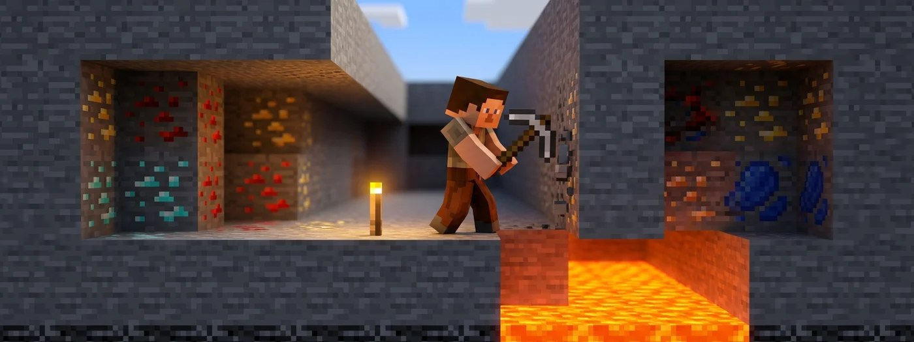

# ⛏️ Erze & Diamanten finden

<figure><figcaption></figcaption></figure>

Auf der 1.8 liegen die Erze anders als in neueren Minecraft-Versionen. Die Welt ist niedriger, und Diamanten findest du knapp über den Lavaseen. Hier steht, auf welcher Höhe du suchen solltest und wo du auf GrieferGames abbauen kannst.

## Deine Höhe herausfinden

Die Höhe ist die Y-Koordinate. Drücke F3. Die Y-Koordinate steht in der Zeile „XYZ“ an zweiter Stelle.
Die Welt reicht auf der 1.8 von Y 0 bis Y 255. Ganz unten, auf Y 0 bis 4, liegt Grundgestein. Tiefenschiefer und Kupfer gibt es auf der 1.8 noch nicht.

## Welches Erz wo liegt

| Erz | Kommt vor zwischen | Am häufigsten | Spitzhacke mindestens |
| :--- | :--- | :--- | :--- |
| **Diamant** | Y 1 bis 16 | Y 5 bis 12 | Eisen |
| **Redstone** | Y 1 bis 16 | Y 5 bis 12 | Eisen |
| **Gold** | Y 1 bis 32 | Y 5 bis 28 | Eisen |
| **Lapislazuli** | Y 1 bis 32 | um Y 15 | Stein |
| **Eisen** | Y 1 bis 64 | Y 5 bis 42 | Stein |
| **Kohle** | Y 1 bis 128 | Y 5 bis 42 | Holz |
| **Smaragd** | Y 4 bis 31, nur in Extreme Berge (englisch „Extreme Hills“) | überall gleich | Eisen |
| **Netherquarz** | im ganzen Nether | – | Holz |

Eisen und Gold droppen auf der 1.8 als Erzblock, den du im Ofen zu Barren schmilzt und dabei Erfahrung bekommst. Die Verzauberung Glück bringt hier nichts, und auch Eisenklumpen gibt es auf der 1.8 noch nicht. Diamant, Kohle, Lapislazuli, Redstone, Smaragd und Netherquarz droppen hingegen direkt das Material sowie Erfahrung – hier erhöht Glück die Menge. Mit Behutsamkeit bekommst du das Erz selbst als Block, was sich lohnt, wenn du es erst später mit einem Glück-Werkzeug abbauen willst.
Smaragderz liegt immer einzeln, nie in Adern. Einfacher bekommst du Smaragde beim Handel mit Dorfbewohnern.

Mit einem **Bruchstein- & Erze-Generator** erzeugt ein passiver Spawner mit einem besonderen Spawn-Ei Bruchstein und Erze. Das Rezept findest du in der [Rezeptsammlung](https://wiki.griefergames.net/1-8/funktionen/features/die-rezeptsammlung).


Mit dem **Drop-Booster** (`/booster drop`) bekommst du mehr Items beim Abbauen von Erzen mit einer Spitzhacke. 
Der **Break-Booster** (`/booster break`) lässt dich schneller abbauen ([Booster & Perks](https://wiki.griefergames.net/1-8/funktionen/features/booster-and-perks)).


## Erze abbauen auf GrieferGames

Erze baust du in diesen Welten ab:

- **Farmwelt:** Mit `/warp farmwelt` kommst du hin, mit `/farmwelt` wählst du die Farmwelt eines beliebigen Citybuild-Servers. Rund um den Spawn ist ein Schutzbereich von etwa 300 Blöcken. Mit `/rtp` landest du an einer zufälligen Stelle ([Spielstart und erste Schritte](https://wiki.griefergames.net/1-8/funktionen/spielmodus-citybuild/spielstart-und-erste-schritte)).
- **Nether:** `/nether` öffnet die Auswahl. Dort findest du Netherquarz und Leuchtstein.
- **Farmserver:** Mit `/switch wasser` oder `/switch lava` kommst du auf die [Farmserver Wasser & Lava](https://wiki.griefergames.net/1-8/funktionen/spielmodus-citybuild/farmserver-wasser-and-lava). Sie bestehen nur aus Farmwelt und Nether. Deine Items nimmst du mit auf jeden Citybuild.
- **Zauberwald:** Im Permafrost-Biom bekommst du aus Erz Permafrost-Diamanten und Permafrost-Eisen. Daraus baust du den Gewöhnlichen Zauberstab (Zauberwald).

Wann die Farmwelten das nächste Mal zurückgesetzt werden, zeigt eine Anzeige neben dem Bürgermeister in der [Hauptstadt](https://wiki.griefergames.net/1-8/funktionen/features/die-hauptstadt).


In den Farmwelten ist **PvP** an. Andere Spieler können dich angreifen. Nimm nur mit, was du verlieren kannst.

