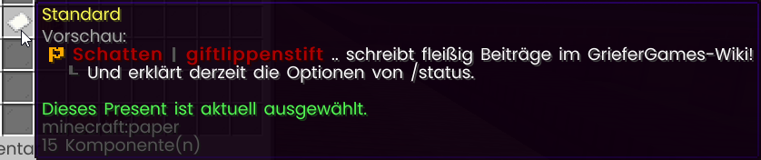
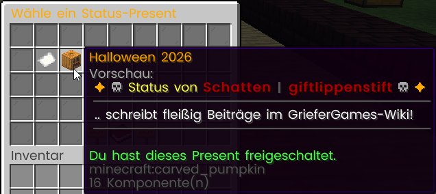

# Rang-Rechte

Mit einem Rang erhältst du zusätzlich zu den [allgemeinen Befehlen](allgemeine-befehle.md) weitere Befehle und Rechte. Wähle unten einen Rang aus, um seine Vorteile zu sehen. Ist in der Spalte „Befehl“ nichts eingetragen, handelt es sich um ein Recht, das ohne eigenen Befehl gilt.



| Befehl | Funktion |
| --- | --- |
| `/msgtoggle` | MSG-Nachrichten zulassen/blockieren |
| `/d chicken` | In ein Huhn verwandeln |
| `/ud` | Verwandlung aufheben |
|  | [Join-Rechte](../../allgemein/server-performance/#join-cap-reservierte-slots-und-whitelists) |
|  | Farbig schreiben |
|  | Farbig auf Schilder schreiben |
| `/rand` | Zugriff auf [Premium-Ränder](../grundstuecke/grundstuecke-veraendern.md#rand) |
|  | Mehr Spielsteine bei 4-Gewinnt |
| `/friend` | 25 [Freundesplätze](../features/das-freunde-system.md) |



| Befehl | Funktion |
| --- | --- |
| `/hat` oder `/head` | Item, welches man in der Hand hält, auf den Kopf setzen |
| `/hat off` oder `/head off` | Item vom Kopf lösen |
| `/nick <Nickname>` | Angezeigten In-Game-Namen ändern |
| `/nick off` | Nickname entfernen |
| `/tptoggle` | Teleportationsanfragen zulassen/blockieren |
| `/schild` | Schilder bearbeiten |
| `/d <cow, creeper, horse>` | In eine Kuh, einen Creeper oder ein Pferd verwandeln |
| `/ud` | Verwandlung aufheben |
| 
<code>/rand</code> <code>/wand</code> <code>/boden</code>
 | Zugriff auf [Ultra-Ränder](../grundstuecke/grundstuecke-veraendern.md#rand), [-Wände](../grundstuecke/grundstuecke-veraendern.md#wand) und [-Böden](../grundstuecke/grundstuecke-veraendern.md#boden) |
| `/sethome` | 
3 Homepunkte (Home-Erweiterung)
 |
|  | 
<a href="../features/das-clan-system.md">5 Clan-Mitglieder</a> (Clan-Erweiterung)
 |



| Befehl | Funktion |
| --- | --- |
| `/p flag set notify-enter` | Erhalte eine Nachricht, wenn Spieler dein Grundstück betreten |
| `/p flag set notify-leave` | Erhalte eine Nachricht, wenn Spieler dein Grundstück verlassen |
| `/p flag set greeting <Text>` | Grußnachricht beim Betreten des Grundstücks anzeigen |
| `/p flag set farewell <Text>` | Grußnachricht beim Verlassen des Grundstücks anzeigen |
| `/p flag set music <ID>` | Musik auf dem Grundstück abspielen |
| `/pholo` | [Hologramm](spezielle-features/hologramme.md) verwalten |
| `/d <guardian, enderman, endermite, iron_golem, magma_cube, ocelot, pig, rabbit>` | In einen Wächter, einen Enderman, eine Endermite, einen Eisengolem, einen Magmaschleim, einen Ozelot, ein Schwein oder ein Kaninchen verwandeln |
| `/ud` | Verwandlung aufheben |
| 
<code>/rand</code> <code>/wand</code> <code>/boden</code>
 | Zugriff auf [Legende-Ränder](../grundstuecke/grundstuecke-veraendern.md#rand), [-Wände](../grundstuecke/grundstuecke-veraendern.md#wand) und [-Böden](../grundstuecke/grundstuecke-veraendern.md#boden) |
| `/friend` | 35 [Freundesplätze](../features/das-freunde-system.md) |
| `/sethome` | 
5 Homepunkte (Home-Erweiterung)
 |
|  | 
7 <a href="../features/das-clan-system.md">Clan-Mitglieder</a> (Clan-Erweiterung)
 |



| Befehl | Funktion |
| --- | --- |
| `/b` | Fett im Chat schreiben |
| `/sign <Signatur>` | Items signieren |
| `/unsign` | Eigene Signatur entfernen (fremde Signaturen nur mit einem [Unsign-Token](../features/booster-and-perks.md#temporaere-perks)) |
| `/kopf <Spieler>` | Einen Kopf von einem Spieler erhalten (auch während der Wartezeit mit einem [Kopf-Token](../besondere-items/kopf-token.md)) |
| `/d <sheep, silverfish, skeleton_horse, slime>` | In ein Schaf, ein Silberfischchen, ein Skelettpferd oder einen Schleim verwandeln |
| `/ud` | Verwandlung aufheben |
| `/prefix` | Zugriff auf einfarbige (gold, rot & blau) und magische Prefixe |
| 
<code>/rand</code> <code>/wand</code> <code>/boden</code>
 | Zugriff auf [Titan-Ränder](../grundstuecke/grundstuecke-veraendern.md#rand), [-Wände](../grundstuecke/grundstuecke-veraendern.md#wand) und [-Böden](../grundstuecke/grundstuecke-veraendern.md#boden) |
| `/friend` | 40 [Freundesplätze](../features/das-freunde-system.md) |
| `/sethome` | 
6 Homepunkte (Home-Erweiterung)
 |
|  | 
10 <a href="../features/das-clan-system.md">Clan-Mitglieder</a> (Clan-Erweiterung)
 |



| Befehl | Funktion |
| --- | --- |
| `/grieferboost` | Erhalte einen zufälligen [Serverbooster](../features/booster-and-perks.md#booster) (alle 14 Tage möglich) |
| `/freekiste` | Erhalte 2 [Epische Kisten](../features/das-case-opening.md) (alle 14 Tage möglich) |
| `/d <minecart, witch, villager, armor_stand, ender_crystal, squid, falling_block, boat>` | In eine Lore, eine Hexe, einen Dorfbewohner, einen Rüstungsständer, einen Enderkristall, einen Tintenfisch, einen Block oder ein Boot verwandeln |
| `/ud` | Verwandlung aufheben |
|  | Items farbig umbenennen |
| 
<code>/rand</code> <code>/wand</code> <code>/boden</code>
 | Zugriff auf [Griefer-Ränder](../grundstuecke/grundstuecke-veraendern.md#rand), [-Wände](../grundstuecke/grundstuecke-veraendern.md#wand) und [-Böden](../grundstuecke/grundstuecke-veraendern.md#boden) |
| `/friend` | 45 [Freundesplätze](../features/das-freunde-system.md) |
| `/sethome` | 
7 Homepunkte (Home-Erweiterung)
 |
|  | 
12 <a href="../features/das-clan-system.md">Clan-Mitglieder</a> (Clan-Erweiterung)
 |
|  | 
Eigene Beschreibung auf dem TeamSpeak-Server ändern
 |
|  | 
Reservierte Slots des TeamSpeak-Servers benutzen
 |



| Befehl | Funktion |
| --- | --- |
| `/skin <Spieler>` | Minecraft-Skin eines anderen Spielers annehmen |
| `/premium <Spieler>` | Einem Spieler ohne Rang den Premium-Rang für 7 Tage geben (alle 7 Tage möglich) |
| `/status <Nachricht>` | Status setzen, der bei jedem Join auf einen Server im [Chat](../features/das-chat-system.md#oeffentlicher-chat) erscheint |
| `/status toggle` | Status an-/ausschalten |
| `/gun` | Paintball-Gun nutzen |
| `/feuerwerk` | Feuerwerk starten |
| 
<code>/rand</code> <code>/wand</code> <code>/boden</code>
 | Zugriff auf [Supreme-Ränder](../grundstuecke/grundstuecke-veraendern.md#rand), [-Wände](../grundstuecke/grundstuecke-veraendern.md#wand) und [-Böden](../grundstuecke/grundstuecke-veraendern.md#boden) |
| `/friend` | 50 [Freundesplätze](../features/das-freunde-system.md) |
| `/sethome` | 
8 Home-Punkte (Home-Erweiterung)
 |
|  | 
15 <a href="../features/das-clan-system.md">Clan-Mitglieder</a> (Clan-Erweiterung)
 |
|  | Chat-Highlighter aktiv (Automatische Leerzeilen) |
|  | 
Zugriff auf persönlichen Helfer auf dem TeamSpeak-Server (!ruhe)
 |



| Befehl | Funktion |
| --- | --- |
| `/globalbroadcast <Nachricht>` | Sendet eine hervorgehobene Nachricht an das Netzwerk. |
| `/ultra <Spieler>` | Einem Spieler ohne Rang dauerhaft den Ultra-Rang vergeben (alle 30 Tage möglich). |
| `@<Spielername>` | Erwähnt einen Spieler im Chat. |
|  | Beim Anklicken eines Heros erhält ein Spieler eine zufällige Anzahl an Kristallen. |
|  | Beim Serverbeitritt (mit aktivem `/status`) wird ein Feuerwerk gezündet. |
|  | Der Rang steht (zusammen mit Helfer) zu Beginn der Tablist. |
|  | 
Der Hero-Rang schreibt standardmäßig orange. Bei Spielererwähnung wird der Text weiß.
 |
|  | 
Zusätzliche Home-Punkte (Home-Erweiterung)
 |
|  | 
Zusätzliche <a href="../features/das-clan-system.md">Clan-Mitglieder</a> (Clan-Erweiterung)
 |



## Der Status

Ab dem **Supreme-Rang** kann man einen eigenen, kurzen Text festlegen, der im Chat aufploppt, sobald man einem Citybuild beitritt. So lässt sich ein cooler Auftritt hinlegen.
Mit dem Befehl /status öffnet man das Menü nd kann den Join-Status ganz nach den eigenen Wünschen anpassen.
In diesem Menü lässt sich alles rund um den Status einstellen:

* **Status-Text (Zeile 1):** Klickt man hierauf, kann man die Nachricht in den Chat tippen. Dafür hat man 20 Sekunden Zeit. Der Text darf nicht leer sein, maximal 255 Zeichen lang sein und unterstützt Farbcodes (wie `&a` oder `&l`).
* **Status-Toggle:** Hier lässt sich der Status ganz einfach an- oder ausschalten. Ist er aus, bleibt man beim Joinen „stumm“.
* **Present wählen:** Hier bestimmt man den Look der Nachricht (siehe unten). *Wichtig: Man kann erst ein Present auswählen, wenn in Zeile 1 ein Text steht!* Ist Zeile 1 leer, wird sowieso nichts gesendet (in der Vorschau steht dann nur das Standard-Present: "ist dem Spiel beigetreten.").

#### Die zweite Zeile (Upgrade)
Hat man die zweite Zeile freigeschaltet, kann man im Menü den Button **„Status-Text (Zeile 2)“** nutzen. Dieser befindet sich rechts unten neben dem Buch.
* **Linksklick:** Text setzen (ebenfalls max. 255 Zeichen).
* **Rechtsklick:** Text löschen.

Diese Zeile erscheint beim Joinen direkt unter der ersten. Man kann sie aber auch einfach leer lassen. Ohne Freischaltung bleibt dieser Knopf gesperrt.

<figure><figcaption></figcaption></figure>

#### Status-Presets
Ein Preset (Status-Present) legt quasi das Design bzw. den Rahmen fest, wie der Status im Chat dargestellt wird. Im Menü sieht man direkt eine Vorschau und erkennt, welche Presets man bereits besitzt. Das Standard-Preset ist von Anfang an vorausgewählt. Weitere Presets lassen sich dauerhaft freischalten (z. B. durch Items aus dem CaseOpening). Es gibt auch saisonale Presets, die nur für begrenzte Zeit verfügbar sind.

<figure><figcaption></figcaption></figure>

