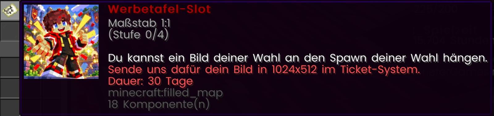
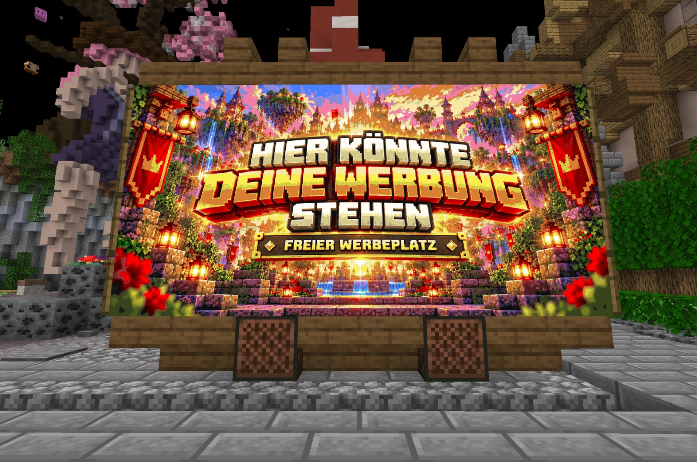

# 🗺️ Werbetafel-Slot

Aus dem CaseOpening kann man ein Item namens „Werbetafel-Slot“ ziehen:

<figure><figcaption></figcaption></figure>

Dieses Item kann im Ticket-System eingelöst werden, um den Platz einer Werbetafel auf einem bestimmten Citybuild zu nutzen. 

<figure><figcaption></figcaption></figure>

Bei Beantragung im Ticket-System müssen wir die Info erhalten, wo genau das Item liegt (Inventar, Enderchest, Showcase, Grundstück,...) - wir nehmen es dann und lösen dafür die Werbetafel ein. Das Wunschbild muss in 1024x512 hochgeladen werden und dazugeschrieben werden, auf welchem Citybuild der Werbetafel-Slot genutzt werden soll. 

Die Werbetafel wird dann auf dem gewählten Citybuild für 30 Tage in Anspruch genommen und rotiert alle 60 Sekunden mit allen anderen dort eingelösten Werbetafeln durch. Ein Ändern des Motivs ist während der Laufzeit nicht möglich. 


Nur der Werbetafel-Slot auf CBEvil kann für Casino-Werbung genutzt werden. Motive, die Spieler als "Trusted" oder "Scammer" bezeichnen, sind nicht erlaubt. QR-Codes sind ebenfalls nicht erlaubt. Generell unterliegt die Nutzung der Werbetafel-Slots dem Regelwerk.

