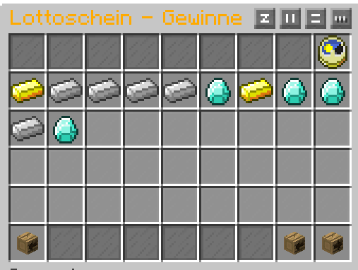
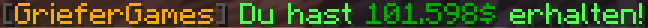
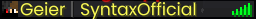
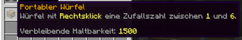
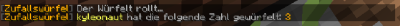

# 🎰 Zufallsbasierte Mechaniken

Auf GrieferGames gibt es verschiedene Situationen, in denen das Ergebnis unklar ist und nicht von euren Fähigkeiten, sondern von eurem Glück abhängt.

### CaseOpening

Das CaseOpening ist ein zufallsbasiertes Kistensystem, bei dem bei jedem Öffnen aus einer größeren Auswahl an Items eine zufällige „Vorauswahl“ getroffen wird und du anschließend aus den ausgewählten Items eines als Gewinn erhältst.

Unterschiedliche Kistenarten enthalten unterschiedliche Item-Pools. Die Vorauswahl wird bei jeder Runde neu erstellt.

Mehr Informationen zum CaseOpening findet ihr im Artikel: [Das Case-Opening](das-case-opening.md)

### Lotterie

Die Lotterie befindet sich in der Hauptstadt und bietet euch bei wöchentlichen Ziehungen die Möglichkeit, den Jackpot zu knacken.

Hierfür könnt ihr bei dem Lotterie-NPC Lottoscheine erwerben und ausfüllen, die bei der nächsten Ziehung ausgewertet werden. Diese Lottoscheine sind in drei Klassen aufgeteilt:

**Silber-Klasse**:

* Basis-Jackpot: 1.000.000 Dollar
* Preis pro Lottoschein: 1.000 Dollar
* Anzahl Kreuze pro Lottoschein: 4

**Gold-Klasse**:

* Basis-Jackpot: 5.000.000 Dollar
* Preis pro Lottoschein: 2.000 Dollar
* Anzahl Kreuze pro Lottoschein: 5

**Diamant-Klasse**:

* Basis-Jackpot: 10.000.000 Dollar
* Preis pro Lottoschein: 3.000 Dollar
* Anzahl Kreuze pro Lottoschein: 6

Der Jackpot erhöht sich in allen Klassen mit jedem gekauften Lottoschein um 25 % des Lottoscheinpreises.


Die Formel für den finalen Jackpot lautet also <kbd>Finaler Jackpot = Basis-Jackpot + (Anzahl Lottoschein-Verkäufe der Klasse \* (Preis pro Lottoschein der Klasse \* 0,25))</kbd>.

Somit wäre z. B. in der Gold-Klasse der Jackpot mit 500 verkauften Lottoscheinen bei 5.250.000 Dollar.


Wenn ihr einen Lottoschein erwerben wollt, könnt ihr je nach Klasse 4 - 6 Kreuze setzen. Nach der Kaufbestätigung können diese Zahlen nicht mehr verändert werden. Eure erworbenen Lottoscheine könnt ihr jederzeit mit euren angekreuzten Zahlen unter „Aktuelle Ziehung“ einsehen.

<figure><figcaption>
» <em>Farmst du noch oder gambelst du schon?</em> «
</figcaption></figure>

Einmal pro Woche werden die Lottozahlen automatisch gezogen. Den genauen Zeitpunkt könnt ihr sehen, wenn ihr mit dem Mauszeiger über die Uhr fahrt.

Euer Gewinn berechnet sich durch die Anzahl an Übereinstimmungen der gezogenen Zahlen mit euren angekreuzten Zahlen.

Haben mehrere Personen die gleiche Anzahl an richtigen Zahlen in einer Klasse, wird der Gewinn aufgeteilt. Hat kein Spieler einer Klasse z. B. drei richtige Kreuze gesetzt, wird der Gewinn den nächsthöheren Gewinnern, in dem Fall den Personen mit vier richtigen Kreuzen, hinzugerechnet. Gibt es niemanden, auf den das Preisgeld weiterverteilt werden kann, verfällt der Gewinn.

Ihr habt ab dem Zeitpunkt der Ziehung eine Woche Zeit, eure Gewinne manuell unter „Letzte Ziehung“ über den Geldsack abzuholen. Nach dem Zeitraum könnt ihr eure alten Lottoscheine nicht mehr einsehen und eure Gewinne werden automatisch eingelöst.

<figure><figcaption>
» <em>400 Euro in der Lotterie gewonnen! Jetzt halbwegs normal weiterleben, damit die Nachbarn nichts merken.</em> «
</figcaption></figure>

### Coinflip

Zu speziellen Events und Aktionen wird das Feature "Coinflip" freigeschaltet.

Über den Befehl `/coinflip <Betrag>` kannst du als Spieler um einen selbst festgelegten Betrag wetten. Die Maximalgrenze pro Vorgang liegt dabei bei **50 Millionen Dollar**.

Du spielst ausschließlich gegen das System und hast die Möglichkeit, deinen Einsatz komplett zu verlieren oder zu verdoppeln. Der Münzwurf wird vom System automatisiert ausgeführt.


Wie bei einer klassischen Münze ist die Chance auf einen Gewinn nicht 50/50, sondern leicht abweichend (Materialabnutzung, Ungleichgewicht, Wurf auf die Kante usw.).

Diese Abweichung resultiert in einem leichten „Vorteil“ für das System. Die genaue Rate wird von der Administration vor dem Event festgelegt und nicht offiziell preisgegeben.

Münzwerfen kann zum Verlust deines Vermögens führen!


Die Statistik zum aktuell laufenden Münzwurf-Event kannst du über den Befehl `/coinflip status` für deine eigene Übersicht oder `/coinflip bank` für eine gesamte Übersicht anzeigen lassen.

## Alles oder Nichts (AON)

Mit dem Minispiel „Alles oder Nichts“ kannst du auf den Citybuilds Geld oder Kristalle fordern. Jeder Versuch kostet einen AON-Token. Liegt deine Forderung im erlaubten, geheimen Bereich, wird dir der Betrag direkt gutgeschrieben. Forderst du jedoch zu viel, gehst du leer aus und erhältst stattdessen zur Strafe den „Geier-Rang“.

1. **Vorbereitung:** Halte einen AON-Token bereit oder löse ein Ticket ein, damit die Tokens deinem Account gutgeschrieben werden.
2. **Übersicht öffnen:** Nutze den Befehl `/aon` (oder `/allesodernichts`), um deine aktuelle Token-Anzahl sowie eine eventuelle Restzeit als Geier zu sehen.
3. **Forderung stellen:** Gib `/aon geld <Anzahl>` oder `/aon kristalle <Anzahl>` ein.


**Pro Versuch wird direkt ein Token verbraucht.** Zwischen zwei Befehlen gilt ein Cooldown von 5 Sekunden. Ist deine Forderung komplett außerhalb der generellen Limits, nennt dir der Befehl die aktuelle Mindest- und Höchstforderung.

Die Tokens erhältst du als „Alles oder Nichts Ticket“ aus dem CaseOpening. Ein Ticket kann mehrere Tokens enthalten (die genaue Anzahl steht auf dem Item). 
* Mit einem Rechtsklick löst du das Ticket ein. 
* Die Tokens sind fest an deinen Account gebunden und können nicht an andere Spieler weitergegeben werden. 
* Ein verbrauchtes Ticket lässt sich nicht erneut nutzen, und ein fehlgeschlagener Versuch erstattet das eingesetzte Token nicht zurück.


Forderst du zu hoch, erhältst du den **Geier-Rang** als zeitlich begrenzten Prefix (14 Tage) vor deinem Namen. 


<figure><figcaption></figcaption></figure>

Solange dieser aktiv ist, kannst du deinen regulären Prefix weder wechseln noch zurücksetzen. Sobald die Zeit abläuft, wird der Geier-Prefix bei deinem nächsten Join automatisch entfernt, und falls du die Strafe erneut erhältst, während der Rang noch läuft, wird die neue Zeit einfach an die bestehende Dauer angehängt.

| Befehl | Funktion |
| --- | --- |
| `/aon` oder `/allesodernichts` | Zeigt deine Tokens, die Restzeit als Geier und die Befehlssyntax |
| `/aon geld <Anzahl>` | Fordert Geld und verbraucht 1 Token |
| `/aon kristalle <Anzahl>` | Fordert Kristalle und verbraucht 1 Token |

Das Token ist verbraucht, sobald der Versuch startet. Bist du bei einer erfolgreichen Geldforderung nicht mehr online, wenn das Geld gutgeschrieben wird, erhältst du es nicht nachträglich.

## Giveaways (Kristalle & Kisten)

Mit einem Giveaway kannst du Kristalle oder Kisten an aktive Spieler auf deinem Citybuild verlosen. Die Gewinne werden komplett vom Server gestellt – du gibst dafür **keine** eigenen Items aus!
1. **Starten:** Führe den entsprechenden Start-Befehl aus. Der Server wählt zufällig einen Gewinnpool und kündigt das Giveaway im Chat an.
2. **Teilnehmen:** Klicke auf die Chatnachricht („Klicke hier, um teilzunehmen!“) oder nutze `/giveawayjoin`. *(Hinweis: Auch der Starter des Giveaways kann und muss sich so eintragen, um gewinnen zu können!)*
3. **Auslosung:** Nach Ablauf der Zeit wird der Gewinn (Kristalle oder Kisten) automatisch unter allen Teilnehmern aufgeteilt und direkt gutgeschrieben.


Du musst bis zum Ende des Giveaways auf demselben Citybuild online bleiben. Wer den Server wechselt oder offline geht, kann nicht gewinnen.


#### Befehle

| Befehl | Funktion |
| --- | --- |
| `/giveaway Kristalle` | Startet ein Kristalle-Giveaway |
| `/giveaway Kisten` | Startet ein Kisten-Giveaway |
| `/giveaways` | Kurzform von `/giveaway` |
| `/giveawayjoin` | Nimmt am laufenden Giveaway teil |

Nach dem Starten eines Giveaways gilt ein S**tandard-Cooldown von 24 Stunden pro Giveaway-Art**, du kannst jedoch beispielsweise direkt nach einem Kristalle-Giveaway ein Kisten-Giveaway auslösen. Beachte dabei, dass auf einem Citybuild immer nur ein Giveaway gleichzeitig laufen kann. 
Falls aktuell kein Gewinnpool vom Server hinterlegt ist, startet das Giveaway nicht und du musst es zu einem späteren Zeitpunkt noch einmal versuchen.

### Würfel

Wann immer man einen [Würfel](https://items.griefergames.net/#Portabler_W%C3%BCrfel) braucht, hier ist er:

<figure><figcaption></figcaption></figure>

Ein Rechtsklick genügt, um den Würfel rollen zu lassen. Nach kurzer Zeit erscheint dann eine Nachricht für alle Spieler auf dem Grundstück oder nur für dich, wenn du auf der Straße stehst.

<figure><figcaption></figcaption></figure>

Du benötigst **keinen** speziellen Rang, um zu würfeln. Es reicht, wenn du den Würfel hast und auf dem Grundstück die [passende Flag](../befehlsuebersicht/grundstuecks-befehle/grundstuecks-flags.md#feature-flags) gesetzt ist **oder** du auf dem Grundstück [Hinzugefügt, Vertraut oder der Besitzer](../befehlsuebersicht/grundstuecks-befehle/grundstuecks-informationen.md) bist.

### LuckyBlöcke

Ein LuckyBlock ist ein Block voller Überraschungen. Sobald du ihn platzierst, öffnet er sich und löst einen zufälligen Effekt aus. LuckyBlöcke bekommst du z. B. im [Admin-Shop](https://wiki.griefergames.net/1-8/funktionen/features/das-adventurer-system#der-admin-shop) des Adventurers.

LuckyBlöcke kannst du nur auf deinem eigenen Grundstück platzieren.

Die Effekte reichen von sehr gut bis sehr schlecht:

**Gute Effekte** z. B. Spawner die vom Himmel regnen, Fledermäuse die beim Erlegen Geld bringen oder ein Lucky-Schwert**Harmlose Scherze** z. B. bunte Regenbogenschafe auf deinem Grundstück**Schlechte Effekte** z. B. TNT-Regen, eine Gruppe Hexen oder ein Aufenthalt im [Gefängnis](https://wiki.griefergames.net/1-8/funktionen/features/die-hauptstadt#das-gefaengnis)


Einige Effekte verändern dein Grundstück, z. B. durch Explosionen, Sandregen oder Glas, das zu Barrieren wird. Bei einem Effekt zahlst du **5 %** deines Geldes an die Spieler auf dem Server aus. Platziere LuckyBlöcke daher mit Bedacht.

