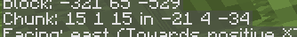
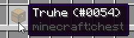

# ⌨️ Nützliche Tasten & Anzeigen

Viele nützliche Infos zeigt Minecraft nur auf Tastendruck: deine Koordinaten, die Chunk-Grenzen oder die ID eines Blocks. Auf der 1.8 fehlen dabei ein paar Tasten, die du vielleicht aus neueren Versionen kennst. Hier steht, was auf der 1.8 geht und wie du dir sonst hilfst.


Auf vielen Laptops und Macs musst du für die Tasten **F1 bis F12** zusätzlich die **Fn**-Taste gedrückt halten.


## Der Debug-Bildschirm (F3)

Mit F3 blendest du den Debug-Bildschirm ein und wieder aus. Links auf dem Bildschirm findest du dann die wichtigsten Daten zu deiner Umgebung. Unter **XYZ** steht deine genaue Position, wobei die Y-Koordinate deine Höhe angibt, X nach Osten und Z nach Süden größer wird. In der Zeile **Chunk** siehst du deine genaue Position innerhalb des aktuellen Chunks sowie die Koordinaten des Chunks selbst. **Facing** verrät dir deine Blickrichtung als Himmelsrichtung zusammen mit der Achse, auf die du schaust. Außerdem zeigt dir **Biome** an, in welchem Biom du gerade stehst, und unter **Looking at** findest du die exakten Koordinaten des Blocks, den du in diesem Moment anschaust.

## Chunk-Grenzen finden

Die Tastenkombination F3 + G, die in neueren Versionen die Chunk-Grenzen einblendet, gibt es auf der 1.8 noch nicht. Sie kam erst mit Minecraft 1.10 ins Spiel. Um die Grenze trotzdem zu finden, drückst du F3 und schaust links in die Zeile **Chunk**. Die Zahlen dort zeigen dir, wo du im Chunk stehst, und laufen von 0 bis 15. Wenn du nun langsam in eine Richtung läufst und eine der Zahlen von 15 auf 0 springt, hast du genau in diesem Moment eine Chunk-Grenze überschritten. Ein Chunk ist immer 16 × 16 Blöcke groß und reicht über die komplette Höhe der Welt. Setz dir an der gefundenen Grenze am besten eine Reihe Blöcke als Markierung auf den Boden. Ein Beispiel dafür findest du im Tutorial **Vom Bild zur Karte**.

<figure><figcaption></figcaption></figure>

## Tastenkombinationen mit F3

Halte F3 gedrückt und drück dann die zweite Taste:

| Kombination | Was passiert |
| :--- | :--- |
| **F3 + H** | **Erweiterte Schnellinfo:** Im Inventar steht hinter dem Namen die Zahlen-ID. Bei beschädigten Werkzeugen und Rüstungen siehst du die genaue Haltbarkeit. |
| **F3 + B** | Zeigt die Hitboxen von Kreaturen, Spielern und herumliegenden Items, inklusive Blickrichtung. |
| **F3 + A** | Lädt alle Chunks neu, z. B. wenn ein Loch in der Welt angezeigt wird. |
| **F3 + D** | Leert den Chat. |


Die Zahlen-ID aus **F3 + H** brauchst du für die Use-Flag, mit der du bestimmte Blöcke auf deinem Grundstück für andere Spieler freigibst: `/p flag set use <ID>`. Mehr dazu unter **[Grundstücks-Flags](https://wiki.griefergames.net/1-8/funktionen/befehlsuebersicht/grundstuecks-befehle/grundstuecks-flags)**.


<figure><figcaption></figcaption></figure>

## Weitere Tasten

Drückst du **F5** zweimal, siehst du dich selbst von vorne.

| Taste | Was passiert |
| :--- | :--- |
| **F1** | Blendet alle Anzeigen aus – praktisch für Screenshots. |
| **F2** | Macht einen Screenshot. Er landet im Ordner `screenshots` in deinem `.minecraft`-Ordner. |
| **F5** | Wechselt die Ansicht: aus deinen Augen, von hinten und von vorne. |
| **F11** | Schaltet das Vollbild an und aus. |
| **Tab** *(gedrückt halten)* | Zeigt einen Teil der Spieler auf dem Citybuild an. |
| **Shift + Klick** | Verschiebt einen kompletten Item-Stapel schnell zwischen Truhe und Inventar. |

## Sichtweite

Die Sichtweite stellst du im Spiel unter *Optionen → Grafikeinstellungen* ein. Sie legt fest, wie viele Chunks du in jede Richtung sehen kannst – je nach Leistung deines Rechners bis zu 32 Chunks. Je mehr du einstellst, desto mehr Leistung braucht dein PC. Ruckelt das Spiel, hilft es oft schon, eine kleinere Sichtweite zu wählen.
