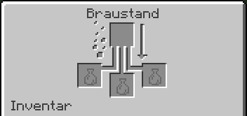

# 🧪 Tränke brauen

Auf der 1.8 braust du Tränke wie in Minecraft 1.8. Einiges aus neueren Versionen gibt es hier noch nicht, z. B. Verweiltränke oder das Totem. Hier steht, wie das Brauen funktioniert und welche Tränke dir GrieferGames zusätzlich bietet.

## Der Braustand

Den Braustand stellst du aus 1 Lohenrute und 3 Bruchstein her. Lohenruten bekommst du von Lohen in Netherfestungen. In den Nether kommst du mit `/warp nether` oder `/nether`. 

Auf der 1.8 braucht der Braustand **keinen Brennstoff**. Lohenstaub als Brennstoff kam erst mit Minecraft 1.9.
Oben legst du die Zutat hinein, unten bis zu drei Flaschen. Pro Durchgang wird nur eine Zutat verbraucht. Fülle deshalb immer alle drei Flaschen.

<figure><figcaption></figcaption></figure>

Glasflaschen stellst du aus 3 Glas her (ergibt 3 Flaschen). Fülle sie an einer Wasserquelle oder an einem Kessel mit Wasser.


Andere Spieler dürfen deine Braustände erst benutzen, wenn du sie freigibst: im Use-Flag-Menü des Grundstück-Menüs (/p) bei Braustände oder mit /p flag set use 117.


## So braust du einen Trank

1. Lege Wasserflaschen in die unteren Felder.
2. Braue Netherwarze hinein. Daraus wird ein Seltsamer Trank. Netherwarzen findest du in Netherfestungen, auf Seelensand kannst du sie anpflanzen.
3. Braue die Effektzutat hinein (siehe Tabelle).
4. Optional: Redstone-Staub für eine längere Wirkung oder Leuchtsteinstaub für eine stärkere.
5. Optional: Schwarzpulver macht daraus einen Wurftrank.


Die meisten Effektzutaten ergeben in einer reinen Wasserflasche nur einen Trank ohne Wirkung. Netherwarze muss immer zuerst hinein. 
Außerdem lassen sich komprimierte Items nicht im Braustand verwenden.


Ein Durchgang dauert 20 Sekunden.

## Die Tränke der 1.8

| Trank | Zutat | Wirkung | Länger | Stärker |
| :--- | :--- | :--- | :---: | :---: |
| **Feuerresistenz** | Magmacreme | Kein Schaden durch Feuer und Lava | ✓ | – |
| **Heilung** | Glitzernde Melonenscheibe | Sofort Herzen zurück | – | ✓ |
| **Regeneration** | Ghast-Träne | Herzen kommen nach und nach zurück | ✓ | ✓ |
| **Stärke** | Lohenstaub | Mehr Schaden im Nahkampf | ✓ | ✓ |
| **Schnelligkeit** | Zucker | Schneller laufen | ✓ | ✓ |
| **Sprungkraft** | Hasenpfote | Höher springen | ✓ | ✓ |
| **Nachtsicht** | Goldene Karotte | Im Dunkeln alles hell sehen | ✓ | – |
| **Unterwasseratmung** | Kugelfisch | Unter Wasser keine Luft verlieren | ✓ | – |
| **Vergiftung** | Spinnenauge | Schaden über Zeit, tötet aber nicht | ✓ | ✓ |


**Ein Trank ist entweder verlängert oder verstärkt, nicht beides!** Mit Redstone-Staub wirken z. B. Feuerresistenz oder Schnelligkeit 8 statt 3 Minuten. Leuchtsteinstaub bringt Stufe II, die Wirkung hält dafür kürzer. 


**Goldene Karotte** und **Glitzernde Melonenscheibe** stellst du aus einer Karotte bzw. Melonenscheibe und 8 Goldklumpen her. Kugelfische bekommst du beim Angeln, Hasenpfoten lassen Kaninchen selten fallen.

## Umkehren mit dem Fermentierten Spinnenauge

DDas **fermentierte Spinnenauge** stellst du aus Spinnenauge, braunem Pilz und Zucker her, in beliebiger Anordnung. 
Es dreht einen Trank um:

|  Aus.. | wird.. |
| --- | --- |
| Nachtsicht | Unsichtbarkeit |
| Schnelligkeit oder Sprungkraft | Langsamkeit |
| Heilung oder Vergiftung | Schaden |
| Wasserflasche | Schwäche |

## Wurftränke

Mit **Schwarzpulver **wird aus jedem Trank ein Wurftrank. Er wirkt auf alle Spieler und Kreaturen in der Nähe des Aufpralls, auch auf dich. Auf der 1.8 wirkt ein Wurftrank kürzer als derselbe Trank zum Trinken.

## Tränke und Effekte von GrieferGames

- Flug- und Abbautränke: Beim [Orb-Verkäufer](https://wiki.griefergames.net/1-8/funktionen/features/das-orb-system#der-orb-verk%C3%A4ufer-verk%C3%A4ufer) kaufst du mit Orbs den Flugtrank (15 Minuten fliegen, auf deinem Grundstück und in der Farmwelt) und den Abbautrank (15 Minuten schneller abbauen). Beide gibt es auch als Wurftrank für eine ganze Gruppe. Details unter [Booster & Perks](https://wiki.griefergames.net/1-8/funktionen/features/booster-and-perks).
- Perks: Effekte wie Feuerresistenz, Unterwasseratmung, Nachtsicht oder Unsichtbarkeit bekommst du dauerhaft als Perk. Mit /perks schaltest du sie an und aus. Im [Zauberwald](https://wiki.griefergames.net/1-8/funktionen/features/der-zauberwald) wirken sie nicht.
- Cola: Ein Spezial-Rezept aus `/rezepte`. Sie gibt dir 90 Sekunden lang Schnelligkeit II.
- Tränke sortieren: Mit dem Effekt-Filter im [Trichter-System](https://wiki.griefergames.net/1-8/funktionen/features/das-trichter-system#item-filter) nimmt ein Trichter nur Tränke mit bestimmten Effekten auf.

## [#](#überschrift)Effekte wieder loswerden

Wenn du einen Trankeffekt vorzeitig beenden möchtest, kannst du einfach einen **Milcheimer** trinken.
**Milch** entfernt sofort alle aktiven Effekte – sowohl die negativen (wie Vergiftung) als auch die positiven (wie Stärke oder Feuerresistenz).

## Was es auf der 1.8 noch nicht gibt

| Was | Kam mit Minecraft |
| :--- | :---: |
| **Lohenstaub** als Brennstoff im Braustand | 1.9 |
| **Verweiltränke**, **Drachenatem**, **getränkte Pfeile** | 1.9 |
| **Trank des Glücks** (auch später nicht braubar) | 1.9 |
| **Totem der Unsterblichkeit** | 1.11 |
| **Trank des sanften Falls**, **Trank des Schildkrötenmeisters** | 1.13 |
| **Tränke des Schleimens, Webens, Befalls und der Windladung** | 1.21 |


Das alles gibt es auf der **Cloud**, die immer auf der aktuellen Minecraft-Version läuft. Mehr dazu im [Cloud-Wiki](https://wiki.griefergames.net/cloud).

