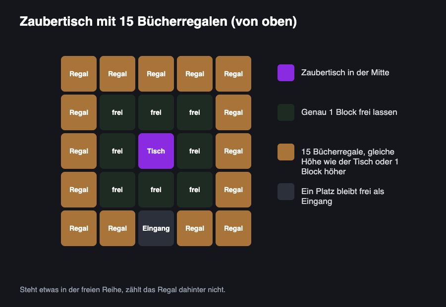

# ✨ Verzaubern & Reparieren
---

Die 1.8 läuft auf Minecraft 1.8. Dort gibt es noch keinen Schleifstein und keine Verzauberung Reparatur (Mending). Hier erfährst du, wie du trotzdem an gute Ausrüstung kommst, warum der Amboss irgendwann „Zu teuer!“ sagt und welche Hilfen es auf GrieferGames gibt.

## Am Zaubertisch verzaubern

Für einen Zaubertisch brauchst du 1 Buch, 2 Diamanten und 4 Obsidian. Lege den Gegenstand ins linke Feld und 1 bis 3 Lapislazuli ins rechte. Dann erscheinen bis zu drei Angebote.

- Die Zahl am Angebot ist das Level, das du mindestens haben musst.
- Abgezogen werden nur 1, 2 oder 3 Level und genauso viele Lapislazuli.
- Fährst du mit der Maus über ein Angebot, siehst du eine Verzauberung, die du sicher bekommst. Es können noch weitere dazukommen.
- Die Angebote ändern sich erst, wenn du etwas verzauberst. Gefällt dir keines, verzaubere etwas Günstiges, z. B. ein Buch.
- Einen Gegenstand, der schon verzaubert ist, kannst du am Zaubertisch nicht noch einmal verzaubern. Weitere Verzauberungen bringst du mit dem Amboss drauf.

## Bücherregale aufstellen

Ohne Bücherregale gibt es nur Angebote bis Level 8. Mit 15 Bücherregalen bekommst du Angebote bis Level 30, mehr geht nicht.

<figure><figcaption></figcaption></figure>

Um die maximale Stufe beim Verzaubern freizuschalten, stellst du Bücherregale mit **genau einem Block Abstand** rund um den Zaubertisch auf. Dabei dürfen sich die Regale entweder auf derselben Höhe wie der Tisch oder **einen Block höher** befinden. Achte unbedingt darauf, dass die Lücke zwischen dem Zaubertisch und den Bücherregalen komplett **frei bleibt** – selbst ein kleiner Gegenstand wie eine Fackel oder ein Teppich an dieser Stelle führt dazu, dass das dahinterliegende Regal nicht mehr mitgezählt wird.

## Mit dem Amboss

Der Amboss ist die perfekte Ergänzung zum Zaubertisch. Für jede Aktion am Amboss benötigst du ein paar Erfahrungslevel. Du hast dort vier Möglichkeiten:

* **Verzauberte Bücher nutzen:** Übertrage die Verzauberung von einem **verzauberten Buch** gezielt auf deinen Gegenstand.
* **Gegenstände kombinieren:** Lege zwei gleiche Gegenstände zusammen (z. B. zwei Diamantschwerter). Dabei wird ihre **Haltbarkeit addiert** und die **Verzauberungen beider Items werden kombiniert** bzw. aufgewertet.
* **Mit Material reparieren:** Repariere beschädigte Ausrüstung direkt mit dem passenden Grundmaterial (z. B. eine Diamantspitzhacke mit einzelnen Diamanten), ohne dass deine Verzauberungen verloren gehen.
* **Gegenstände umbenennen:** Gib jedem beliebigen Item im oberen Textfeld einen eigenen Namen.

Jedes Mal, wenn ein Gegenstand den Amboss benutzt, wird er für den nächsten Durchgang teurer:

| Bisherige Ambossnutzungen | Aufschlag beim nächsten Mal |
| :---: | :---: |
| 0 | + 0 Level |
| 1 | + 1 Level |
| 2 | + 3 Level |
| 3 | + 7 Level |
| 4 | + 15 Level |
| 5 | + 31 Level |

Kostet ein Schritt **40 Level oder mehr**, zeigt der Amboss **„Zu teuer!“**. Dann geht für diesen Gegenstand am Amboss nichts mehr.


Auf der 1.8 zählt auch Umbenennen als Nutzung im Amboss. Jedes Umbenennen macht den Gegenstand für das nächste Mal teurer. Das gilt auch für `/rename` und `/renameinv` ([Booster & Perks](https://wiki.griefergames.net/1-8/funktionen/features/booster-and-perks)). 
Lege außerdem verzauberte Bücher zuerst untereinander zusammen und bring sie dann in einem Schritt auf den Gegenstand. Benenne ganz am Ende im selben Schritt um.


Nicht alle Verzauberungen vertragen sich miteinander. Einige Effekte schließen sich gegenseitig aus, sodass sie auch am Amboss nicht gemeinsam auf denselben Gegenstand gebracht werden können. Bei Werkzeugen musst du dich immer zwischen Behutsamkeit und Glück entscheiden. Auch bei Rüstungen gilt dieses Prinzip: Die vier Schutzarten Schutz, Feuerschutz, Explosionsschutz und Schussschutz lassen sich nicht auf einem Rüstungsteil mischen, ebenso wenig wie Schärfe, Bann und Nemesis der Gliederfüßer.

## Die wichtigsten Verzauberungen der 1.8

| Verzauberung | Für | Höchste Stufe | Was sie macht |
| :--- | :--- | :---: | :--- |
| **Effizienz** | Werkzeuge | V | Schneller abbauen |
| **Haltbarkeit** | alles mit Haltbarkeit | III | Nutzt sich langsamer ab |
| **Behutsamkeit** | Werkzeuge | I | Du bekommst den Block selbst, z. B. Erzblöcke, Glas oder Eis |
| **Glück** | Werkzeuge | III | Mehr Drops bei Kohle, Diamant, Lapislazuli, Redstone, Smaragd und Netherquarz |
| **Schärfe** | Schwert | V | Mehr Schaden |
| **Plünderung** | Schwert | III | Mobs lassen mehr fallen |
| **Schutz** | Rüstung | IV | Weniger Schaden durch fast alles |
| **Federfall** | Stiefel | IV | Weniger Fallschaden |
| **Dornen** | Rüstung | III | Angreifer bekommen selbst Schaden |
| **Wasseraffinität** | Helm | I | Unter Wasser normal schnell abbauen |
| **Wasserläufer** | Stiefel | III | Unter Wasser schneller bewegen, neu in 1.8 |
| **Stärke** | Bogen | V | Mehr Pfeilschaden |
| **Unendlichkeit** | Bogen | I | Ein Pfeil im Inventar reicht |

## [#](#überschrift)Erfahrung sammeln und abfüllen

Erfahrung bekommst du, wenn du Monster und Tiere tötest, Erze wie Kohle, Diamant oder Redstone abbaust, etwas im Ofen schmilzt und herausnimmst, angelst, Tiere züchtest oder mit Dorfbewohnern handelst. Stirbst du, verlierst du deine Erfahrung sofern du das Keep-XP-Perk nicht aktiviert hast. Nur ein Teil bleibt als Kugeln liegen.

Auf GrieferGames hilft dir außerdem:- `/e all` füllt alle Erfahrungspunkte in XP-Flaschen, `/e <Anzahl>` nur einen Teil. 1 Erfahrungspunkt ergibt 1 Flasche (Allgemeine Befehle).
- Passive Spawner sammeln Erfahrung. Du bekommst sie, sobald du Items aus dem Spawner-Lager nimmst.
- Der XP-Booster (`/booster xp`) und die Perks Doppelte XP, Vierfach XP und KeepXP (Booster & Perks). Mit KeepXP behältst du deine Erfahrung, wenn du stirbst.


Die Level im [GrieferPass](https://wiki.griefergames.net/1-8/funktionen/features/grieferpass) sind etwas anderes. Sie haben nichts mit deinen Minecraft-Level zu tun.


## Extras auf GrieferGames

- [Verzauberungs-Upgrade](https://wiki.griefergames.net/1-8/funktionen/besondere-items/verzauberungs-upgrade): erhöht eine einzelne Verzauberung um eine Stufe
- [Verzauberungs-Entferner](https://wiki.griefergames.net/1-8/funktionen/besondere-items/verzauberungs-entferner): entfernt eine einzelne Verzauberung, die Amboss-Kosten bleiben gleich
- [Reparatur-Barren](https://wiki.griefergames.net/1-8/funktionen/besondere-items/reparatur-barren): repariert Rüstung, Werkzeuge, Bögen und Schwerter zu hohen Level-Kosten vollständig
- Amboss-Recht aus dem CaseOpening: ein mobiler Amboss ([Booster & Perks](https://wiki.griefergames.net/1-8/funktionen/features/booster-and-perks#perks--rechte))
- Ambosse und Zaubertische auf deinem Grundstück für alle freigeben: im [Grundstück-Menü](https://wiki.griefergames.net/1-8/funktionen/grundstuecke/grundstueck-menue) unter Use-Flag-Menü oder über die Item-ID
- [Perks](https://wiki.griefergames.net/1-8/funktionen/features/booster-and-perks#perks--rechte): Mit Keep XP behältst du deine Level, wenn du stirbst
